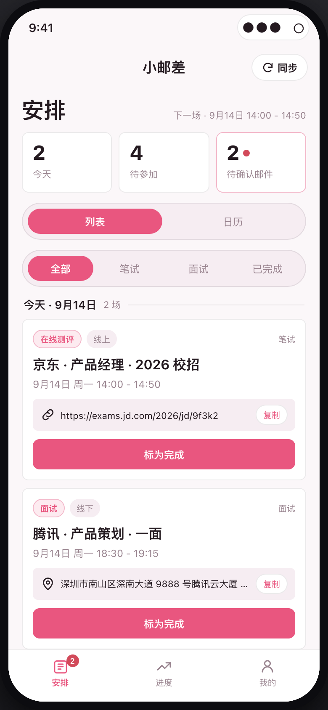
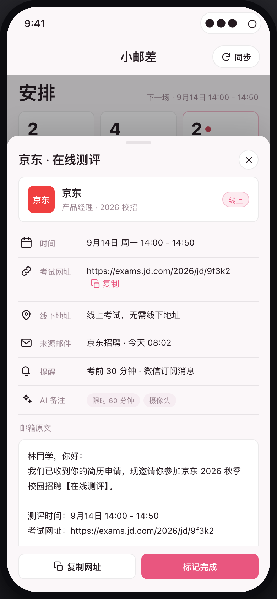
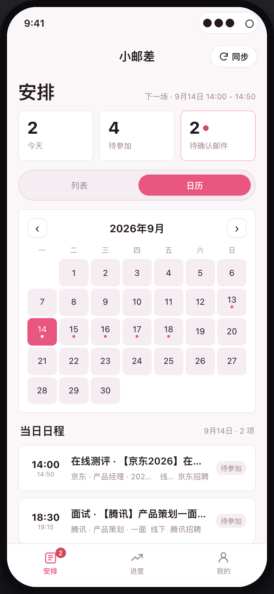
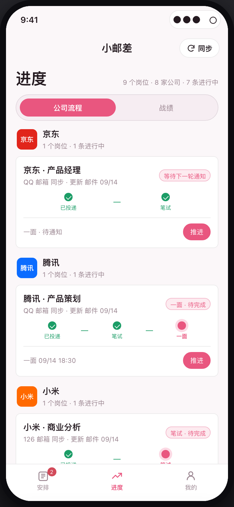
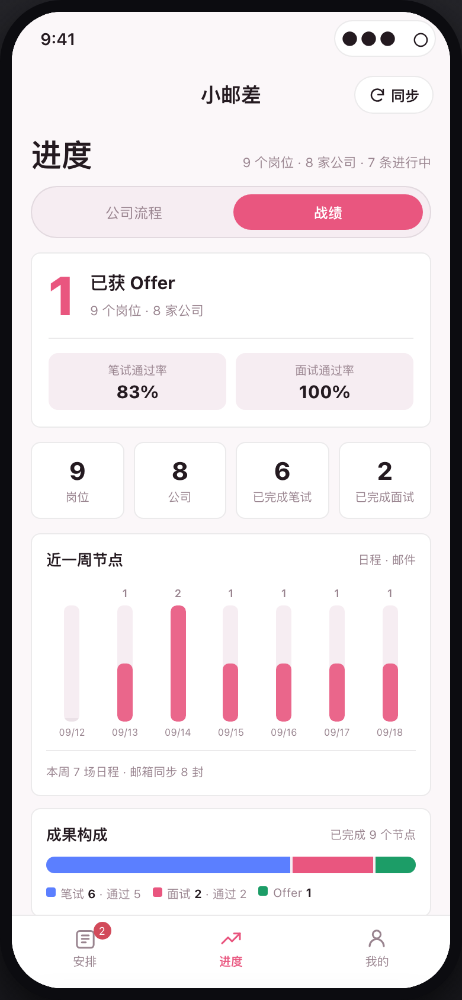
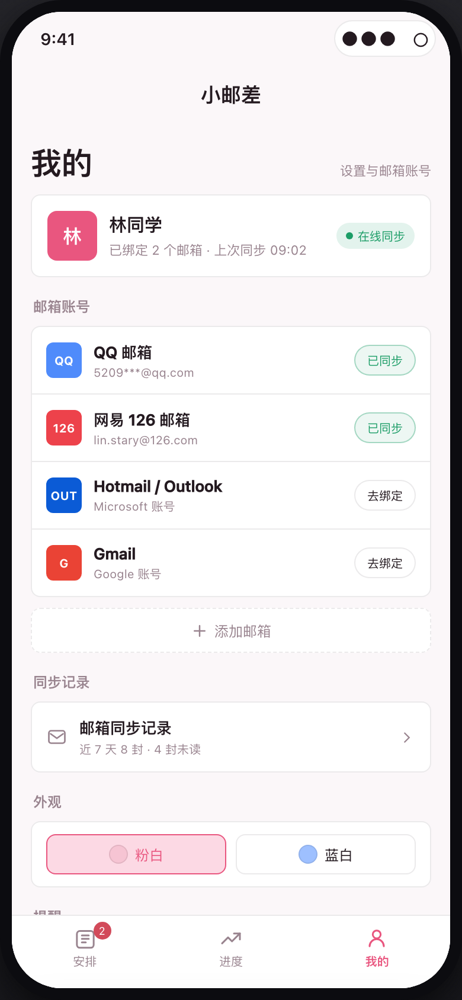

<div align="center">

# 小邮差

**把散落在邮箱里的笔试和面试，变成一张不会错过的日程表。**

校招求职助手 · 微信小程序

[在线体验](https://lxuanxuan124-sketch.github.io/xiaoyouchai-agent/) · [核心功能](#三核心功能) · [技术实现](#五技术实现)

</div>



---

## 一、为什么做这个产品

秋招是一场信息战。

一个校招生通常会同时投 70–100 家公司，笔试、面试、测评邀请散落在 QQ 邮箱、网易邮箱、Gmail 里。真正的问题不是"没有待办工具"，而是：

- 信息在邮箱里，用户不会主动二次录入；
- 每封招聘邮件格式不同，关键信息（时间、地址、网址）藏在大段正文里；
- 漏掉一场笔试，可能直接结束一个机会。

所以「小邮差」的切入点不是"再做一个日程 App"，而是**把邮箱这个现成的信息源，自动变成结构化的日程和待办**。

## 二、产品定位

> 面向校招生的秋招全流程自动追踪小程序。

核心链路：

`绑定邮箱 → 自动同步 → AI 解析邮件 → 生成待办/日程 → 进度追踪 → 提醒 → 战绩复盘`

产品边界：

- 只做信息搬运、结构化与提醒，不预测面试结果；
- 只读取笔试/面试相关字段，不碰私人邮件内容；
- AI 不确定时交给用户确认，不擅自生成错误日程。

## 三、核心功能

### 1. 邮箱绑定与自动同步

- 支持 QQ 邮箱、网易 126、Outlook、Gmail 等多邮箱绑定；
- 授权后自动同步，持续监测新邮件；
- 首页展示在线同步状态、最近同步时间、近 7 天邮件数与未读数；
- 只读取笔试 / 面试相关字段，降低隐私顾虑。

### 2. AI 邮件解析

- 自动判断邮件类型：笔试 / 面试 / 其他；
- 提取公司、岗位、时间、形式（线上 / 线下）、地址、考试网址；
- 附带 AI 备注标签，例如「限时 60 分钟」「摄像头」「携带身份证」；
- 解析结果不确定时进入「待确认」，不直接生成待办。

### 3. 安排：列表 + 日历

- 每封笔试 / 面试邮件自动生成待办，按时间排序、临近置顶；
- 支持「全部 / 笔试 / 面试 / 已完成」筛选；
- 列表与日历双视图，按天查看日程；
- 一键复制考试网址或面试地址、一键标记完成；
- 邮件原文内嵌在详情页底部，核对信息不跳出产品。

### 4. 进度：公司流程 + 战绩

- 按公司 / 岗位展示投递、笔试、面试、Offer 流程；
- 支持同一公司多个岗位的多条流程；
- 只呈现「已通过 / 待完成」，不做结果预测；
- 战绩页展示 Offer 数、笔试通过率、面试通过率、近一周节点和成果构成。

### 5. 我的：邮箱、同步、提醒、主题

- 邮箱账号管理与绑定入口；
- 邮箱同步记录，可回看近 7 天同步情况；
- 提醒设置：考前 30 分钟、考试 / 面试开始前、每日 09:00 汇总；
- 粉白 / 蓝白双主题；
- 数据与隐私说明。

## 四、信息架构

| 页面 | 主要内容 | 关键交互 |
| --- | --- | --- |
| 安排 | 今日概览、待办列表、日历、邮件详情 | 筛选、切换视图、复制、标记完成、查看原文 |
| 进度 | 公司流程、战绩看板 | 通过 / 结束、查看多岗位流程、看统计 |
| 我的 | 邮箱账号、同步记录、提醒、主题、隐私 | 绑定邮箱、查看同步、切换主题 |

底部三 Tab，对应校招生最高频的三个问题：**我今天要做什么、我投到哪一步了、我的邮箱还正常吗。**

## 五、技术实现

前端采用单文件结构，HTML / CSS / JavaScript 内联，无构建、无依赖；通过 CSS 变量实现粉白 / 蓝白双主题；页面适配桌面与移动端。

系统链路：

```
邮箱 OAuth / IMAP
      ↓
邮件同步服务（增量拉取、去重）
      ↓
LLM 结构化解析（公司 / 岗位 / 时间 / 地点 / 网址）
      ↓
结构化存储（云开发数据库）
      ↓
小程序端：待办、日历、进度、战绩
      ↓
微信订阅消息提醒
```

## 六、界面预览

| 安排 · 列表 | 邮件详情 · 原文内嵌 | 安排 · 日历 |
|:---:|:---:|:---:|
|  |  |  |

| 进度 · 公司流程 | 进度 · 战绩 | 我的 · 邮箱与主题 |
|:---:|:---:|:---:|
|  |  |  |

## 七、迭代记录

- **v0.1 基础框架**：三 Tab 信息架构、待办列表、日历视图；
- **v0.2 邮件详情**：原文内嵌、复制网址 / 地址、标记完成；
- **v0.3 待确认闭环**：待确认邮件、红点角标、忽略 / 重新识别、同步记录；
- **v0.4 战绩看板**：Offer 数、笔试 / 面试通过率、近一周节点、成果构成；
- **v0.5 体验打磨**：粉白 / 蓝白双主题、响应式适配、空状态文案。

---

一个面向 AI 产品经理方向的作品：从真实校招场景出发，把"邮箱信息过载"拆成可被 AI 结构化的产品链路，并完成信息架构与交互设计。如果这个项目对你有帮助，欢迎 Star ⭐
